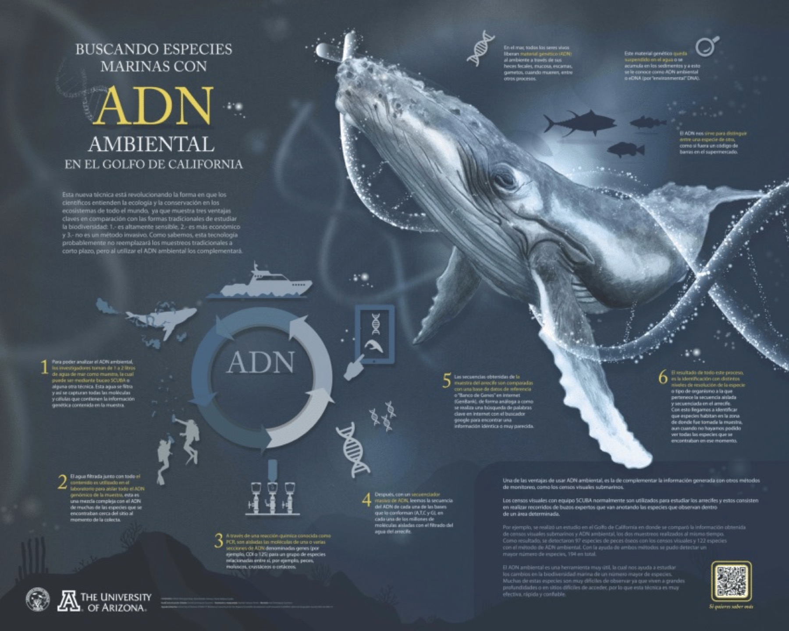

En los medios
======
* **Bento Bio:** [Searching for vaquita DNA and building conservation capacity in Mexico](https://bento.bio/story/searching-for-vaquita-dna-and-building-conservation-capacity-in-mexico/)
* **Excélsior** (Méndez, 10 de julio de 2026): [Avistan tres vaquitas marinas y registran 40 alertas acústicas en el Alto Golfo de California](https://www.excelsior.com.mx/nacional/avistan-tres-vaquitas-marinas-y-registran-40-alertas-acusticas-alto-golfo-california)
* **Excélsior** (Méndez, 19 de mayo de 2026): [Inicia Crucero Vaquita para entrenar observadores y rastreadores moleculares](https://www.excelsior.com.mx/nacional/inicia-crucero-vaquita-para-entrenar-observadores-rastreadores-moleculares)
* **Excélsior** (Pacheco, 16 de junio de 2025): [Tras la huella de las especies marinas; ADN ambiental](https://www.excelsior.com.mx/nacional/tras-la-huella-de-las-especies-marinas-adn-ambiental/1721797), un perfil sobre mi trayectoria y el uso del ADN ambiental para buscar a la vaquita marina ([versión impresa, p. 20](https://www.excelsior.com.mx/Periodico/flip-nacional/16-06-2025/portada.pdf)).
* **Animal Político** (5 de julio de 2024): [ADN ambiental, la tecnología para detectar a la vaquita marina en el Alto Golfo de California](https://www.youtube.com/watch?v=I8yP3dGSyI4&t=152s)
* **Noticias Imagen con Francisco Zea** (18 de junio de 2024): entrevista televisiva sobre el monitoreo de la vaquita marina con ADN ambiental.
* **Mongabay** (14 de junio de 2024): [México: los números de vaquitas marinas se mantienen estables aunque críticos, según el último censo realizado](https://es.mongabay.com/2024/06/mexico-numeros-de-vaquitas-marinas-se-mantienen-estables-aunque-criticos/)
* **Excélsior** (Méndez, 11 de junio de 2024): [Resultados del Crucero de Observación de la Vaquita Marina; ¿cuántas sobreviven?](https://www.excelsior.com.mx/nacional/resultados-crucero-observacion-vaquita-marina-2024/1656868)
* **Excélsior** (Méndez, 28 de abril de 2024, portada): [Detectan 5 sitios con presencia de la vaquita marina](https://www.excelsior.com.mx/nacional/detectan-5-sitios-con-presencia-de-la-vaquita-marina/1648950) ([versión impresa: "Deja marcas en el agua, como una huella dactilar"](https://www.efinf.com/clipviewer/files/c1636403bc41d227daf6da0087fa0651.pdf))
* **University of Washington, School of Aquatic and Fishery Sciences** (Owen-McLaughlin, 29 de septiembre de 2023): [Advancing eDNA methods to inform ecological and conservation questions](https://fish.uw.edu/2023/09/advancing-edna-methods-to-inform-ecological-and-conservation-questions/), sobre mi trabajo en el Whale and Dolphin Ecology Lab (en inglés).

Divulgación científica
======
* **Capítulo de libro:** "Estudios filogeográficos: enseñanzas para el manejo y conservación de la biodiversidad", en [*La biodiversidad en Baja California Sur. Estudio de Estado*](https://www.biodiversidad.gob.mx/region/EEB/estudios/ee_bcs), Vol. III, CONABIO (2025), pp. 43–56. Una introducción a la filogeografía y la genética del paisaje en la península de Baja California, con el caso de la iguana del desierto.
* **Infografía "Oasis submarinos del cañón de Mar del Plata"** (2025): sobre la expedición Talud Continental IV del Schmidt Ocean Institute, que muestreó ADN ambiental, sedimentos y plancton a 2,900–3,900 m de profundidad.
* **Visita de estudiantes de Ingeniería en Agronomía de la UABC** al CIBNOR (6–7 de noviembre de 2025).
* **"eDNA Day"** en La Paz, Baja California Sur (2019): organización de un evento con pósteres, fotografías y videos sobre metodologías de ADN ambiental para el estudio de la fauna marina.
  * Póster: [Ecosistemas marinos del Golfo de California](https://www.researchgate.net/publication/339162883_Ecosistemas_marinos_del_Golfo_de_California)
  * Póster: [Buscando especies marinas con ADN ambiental](https://www.researchgate.net/publication/339159779_Buscando_especies_marinas_con_ADN_ambiental)
* **Podcast "Mutante: la ciencia cambiante"** (Radio UAEM, 2024), episodio "ADN ambiental en el Golfo de California" con Agustín Ávila Casanueva: la relevancia del ADN ambiental en la investigación de la vaquita marina y el Golfo de California, difundido en plataformas digitales y Radio UAEM.
* **Seminario de posgrado en ecología marina**, CICESE (27 de abril de 2021): [video en Facebook](https://www.facebook.com/posgrado.ecologiamarina.1/videos/316292726731311).
* Entrevista en Radio UABCS, Semana de Posgrado de Baja California (2013).

