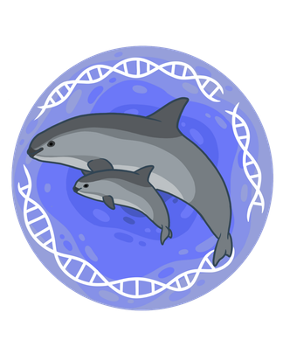
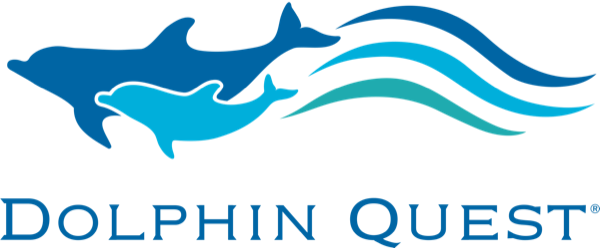
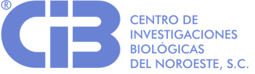
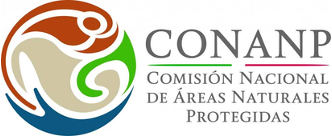
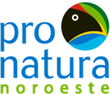
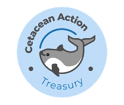

Desarrollo, optimización y validación de ensayos de qPCR y ddPCR para detectar a la vaquita marina (*Phocoena sinus*), el mamífero marino más amenazado del mundo, en muestras de ADN ambiental del Área de Tolerancia Cero del Alto Golfo de California.

* **2025–presente: "Vaquita eDNA Project: A Validated eDNA Workflow for Vaquita Monitoring"** — como investigadora principal, con financiamiento de **Dolphin Quest** y la Dra. Barbara Taylor como co-PI. Es un consorcio internacional con el PNUD, la CONANP, Pronatura Noroeste, Cetacean Action Treasury y el CIBNOR para consolidar un flujo de trabajo validado de ADN ambiental para el monitoreo de la vaquita, con un componente de ciencia ciudadana junto a la Reserva de la Biosfera del Alto Golfo de California.
* **Capacitación comunitaria (2026):** como parte del proyecto Dolphin Quest, cursos de muestreo y procesamiento de ADN ambiental para 12 personas: habitantes de San Felipe, integrantes de Pesca ABC, personal de la CONANP y de la Secretaría de Marina. Los participantes recibieron un *Manual de ADN Ambiental* y equipo de filtración.
* **2024–presente:** "Operation Esperanza" / Vaquita eDNA Project (National Marine Mammal Foundation / NIWC Pacific) — líder del componente de ADN ambiental: ensayos moleculares, optimización del muestreo e informe integral.
* **2024–presente:** desarrollo de marcadores específicos durante mi estancia postdoctoral en el CIBNOR.
* **2021–2022:** "Proyecto piloto para probar la viabilidad de detectar la presencia de vaquitas marinas mediante ADN ambiental" (Cetacean Action Treasury; SeaWorld & Busch Gardens Conservation Fund). Detectamos ADN de vaquita en 5 de los 10 sitios muestreados en el Área de Tolerancia Cero; en dos de ellos coincidió con detecciones acústicas. [Reporte final (Towns y Valdivia-Carrillo, 2023, en inglés)](/files/Towns-Valdivia-2023-vaquita-eDNA-piloto.pdf).

**Financiamiento y socios del proyecto Dolphin Quest:**

  
  
  
  
  

En los medios: [Bento Bio](https://bento.bio/story/searching-for-vaquita-dna-and-building-conservation-capacity-in-mexico/) · [Excélsior 2026](https://www.excelsior.com.mx/nacional/inicia-crucero-vaquita-para-entrenar-observadores-rastreadores-moleculares) · [Excélsior 2024](https://www.excelsior.com.mx/nacional/detectan-5-sitios-con-presencia-de-la-vaquita-marina/1648950) · [Mongabay](https://es.mongabay.com/2024/06/mexico-numeros-de-vaquitas-marinas-se-mantienen-estables-aunque-criticos/) · [YouTube](https://www.youtube.com/watch?v=I8yP3dGSyI4&t=152s)

[← Volver a los proyectos de investigación en el CV](/cv/#proyectos-de-investigación)
