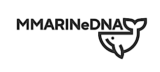
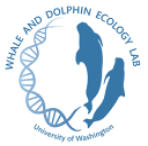

  
  

Mi primer postdoctorado fue en el **[Whale and Dolphin Ecology Lab](https://www.amyvancise.com/)** de la Dra. Amy Van Cise, en la School of Aquatic and Fishery Sciences de la University of Washington, en colaboración con el NOAA Northwest Fisheries Science Center (2023–2024).

Ahí formé parte de **MMARINeDNA** (*Marine Mammal Remote detection via INnovative environmental DNA sampling*), una red que usa ADN ambiental para estudiar la distribución de mamíferos marinos y sus presas en el Sistema de la Corriente de California. Mi trabajo combinó metabarcoding de ADN ambiental y modelos aditivos generalizados (GAMs) para entender la distribución tridimensional de los cetáceos, en colaboración con el Dr. Ryan Kelly (eDNA Collaborative, UW) y la Dra. Kim Parsons (NOAA NWFSC).

En los medios: [UW School of Aquatic and Fishery Sciences, 2023](https://fish.uw.edu/2023/09/advancing-edna-methods-to-inform-ecological-and-conservation-questions/).

Productos:
* Valdivia-Carrillo T *et al.* "Modeling cetacean eDNA distribution along the Washington coast using metabarcoding from opportunistic samples and generalized additive models". En revisión en *Environmental DNA*; [preprint en bioRxiv](https://doi.org/10.1101/2025.11.21.689289).
* [metabarcoding_QAQC_pipeline](https://github.com/MMARINeDNA/metabarcoding_QAQC_pipeline): pipeline colaborativo de control de calidad para metabarcoding.
* [eDNAoccurrenceSDM](https://github.com/taniavaldiviac/eDNAoccurrenceSDM): herramienta en R para modelos de distribución con datos de metabarcoding.

[← Volver a los proyectos de investigación en el CV](/cv/#proyectos-de-investigación)
