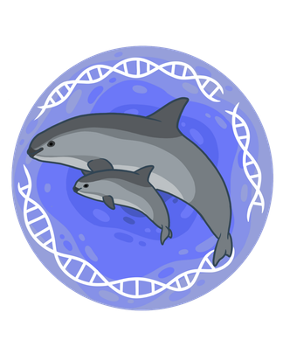
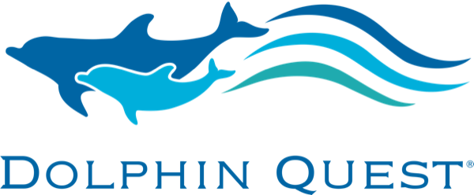
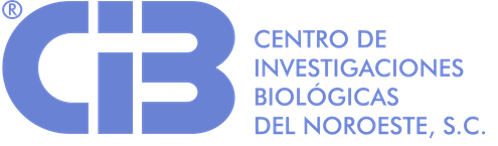
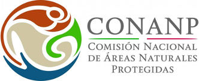
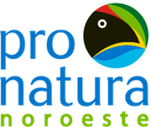
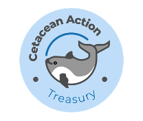

Development, optimization and validation of qPCR and ddPCR assays to detect the vaquita (*Phocoena sinus*), the world's most endangered marine mammal, in environmental DNA samples from the Zero Tolerance Area of the Upper Gulf of California.

* **2025–present: "Vaquita eDNA Project: A Validated eDNA Workflow for Vaquita Monitoring"** — principal investigator, funded by **Dolphin Quest**, with Dr. Barbara Taylor as co-PI. An international consortium with UNDP, CONANP, Pronatura Noroeste, Cetacean Action Treasury and CIBNOR to establish a validated eDNA workflow for vaquita monitoring, including a citizen-science component with the Upper Gulf of California Biosphere Reserve.
* **Community training (2026):** as part of the Dolphin Quest project, eDNA sampling and processing courses for 12 people: San Felipe residents, members of Pesca ABC, and staff from CONANP and the Mexican Navy. Participants received an *Environmental DNA Manual* and filtration equipment.
* **2024–present:** "Operation Esperanza" / Vaquita eDNA Project (National Marine Mammal Foundation / NIWC Pacific) — eDNA component lead: molecular assays, sampling optimization and final report.
* **2024–present:** development of species-specific markers during my postdoctoral position at CIBNOR.
* **2021–2022:** "Pilot project to test the feasibility of detecting vaquitas using environmental DNA" (Cetacean Action Treasury; SeaWorld & Busch Gardens Conservation Fund). We detected vaquita DNA at 5 of the 10 sites sampled in the Zero Tolerance Area; two of them also had acoustic detections. [Final report (Towns and Valdivia-Carrillo, 2023)](/files/Towns-Valdivia-2023-vaquita-eDNA-piloto.pdf).

**Dolphin Quest project funder and partners:**

  
  
  
  
  

In the media: [Bento Bio](https://bento.bio/story/searching-for-vaquita-dna-and-building-conservation-capacity-in-mexico/) · [Excélsior 2026](https://www.excelsior.com.mx/nacional/inicia-crucero-vaquita-para-entrenar-observadores-rastreadores-moleculares) · [Excélsior 2024](https://www.excelsior.com.mx/nacional/detectan-5-sitios-con-presencia-de-la-vaquita-marina/1648950) · [Mongabay](https://es.mongabay.com/2024/06/mexico-numeros-de-vaquitas-marinas-se-mantienen-estables-aunque-criticos/) · [YouTube](https://www.youtube.com/watch?v=I8yP3dGSyI4&t=152s)

[← Back to research projects in my CV](/en/cv/#research-projects)
