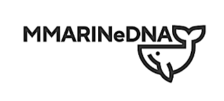
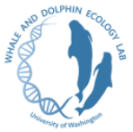

  
  

My first postdoc was in Dr. Amy Van Cise's **[Whale and Dolphin Ecology Lab](https://www.amyvancise.com/)** at the University of Washington's School of Aquatic and Fishery Sciences, in collaboration with NOAA's Northwest Fisheries Science Center (2023–2024).

There I was part of **MMARINeDNA** (*Marine Mammal Remote detection via INnovative environmental DNA sampling*), a network using environmental DNA to study the distribution of marine mammals and their prey in the California Current System. My work combined eDNA metabarcoding and generalized additive models (GAMs) to understand the three-dimensional distribution of cetaceans, in collaboration with Dr. Ryan Kelly (eDNA Collaborative, UW) and Dr. Kim Parsons (NOAA NWFSC).

In the media: [UW School of Aquatic and Fishery Sciences, 2023](https://fish.uw.edu/2023/09/advancing-edna-methods-to-inform-ecological-and-conservation-questions/).

Outputs:
* Valdivia-Carrillo T *et al.* "Modeling cetacean eDNA distribution along the Washington coast using metabarcoding from opportunistic samples and generalized additive models". Under review in *Environmental DNA*; [bioRxiv preprint](https://doi.org/10.1101/2025.11.21.689289).
* [metabarcoding_QAQC_pipeline](https://github.com/MMARINeDNA/metabarcoding_QAQC_pipeline): collaborative quality-control pipeline for metabarcoding.
* [eDNAoccurrenceSDM](https://github.com/taniavaldiviac/eDNAoccurrenceSDM): R tool for species distribution models with metabarcoding data.

[← Back to research projects in my CV](/en/cv/#research-projects)
